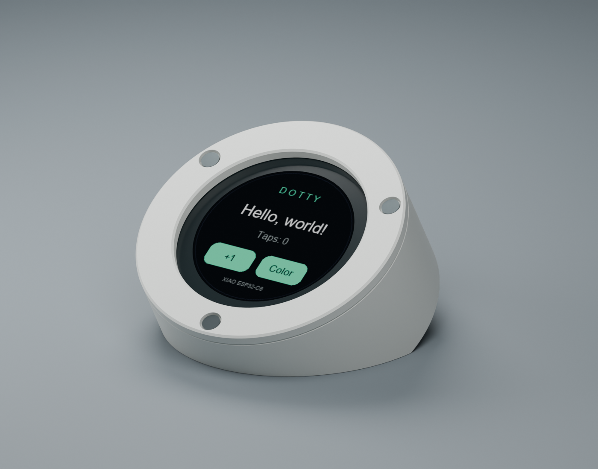
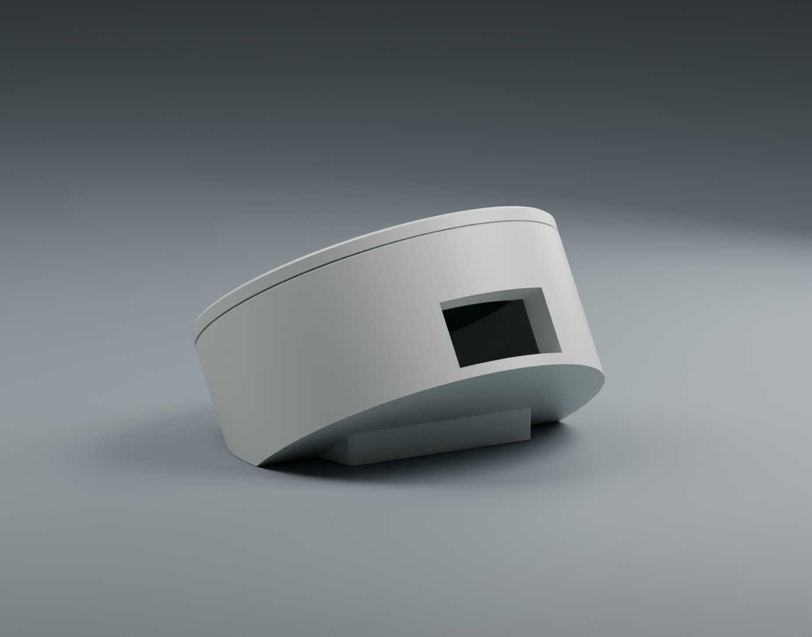
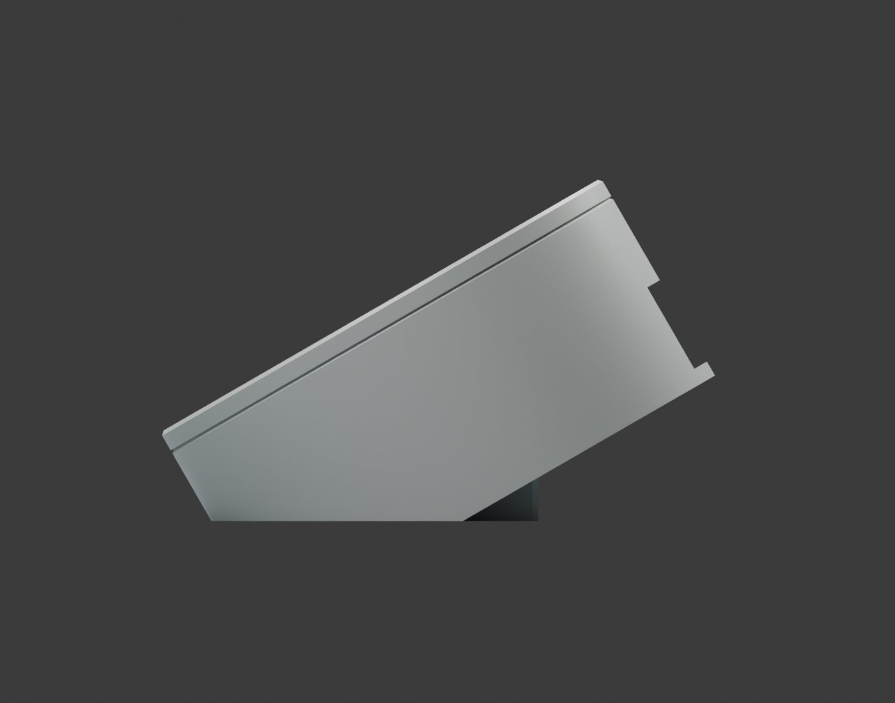
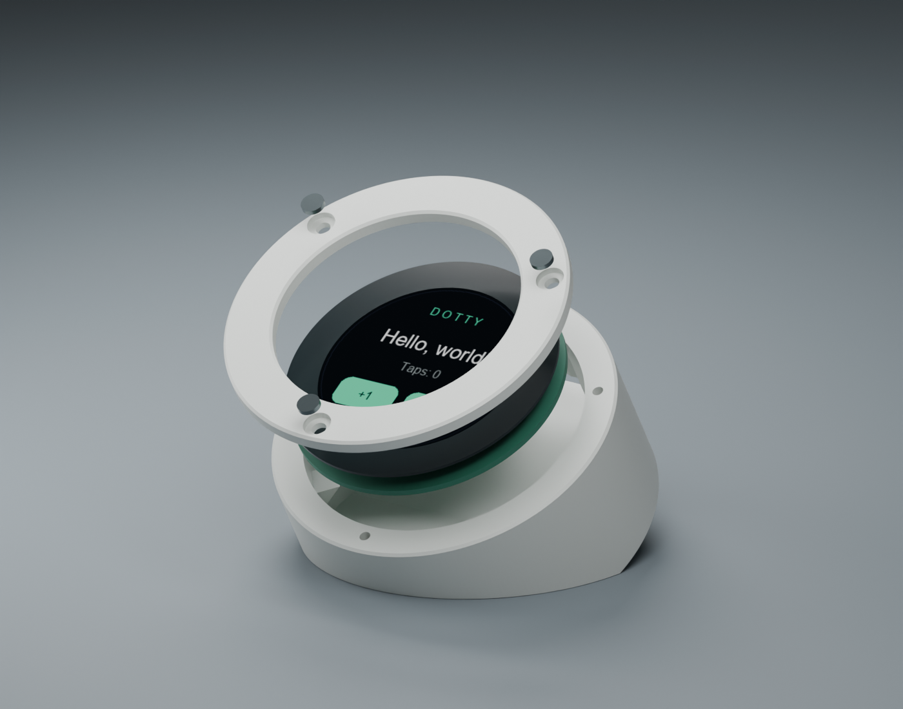

# Dotty

A small desktop puck for **Seeed Studio XIAO ESP32-C6 + Round Display for XIAO**, with a flat bottom sliced directly into the puck, so its screen sits **30 degrees above a horizontal desk**. The rear is sliced **parallel to the display face**, making a finite, constant-thickness puck. A separate horizontal slice through its underside lets it sit on the desk like a puck partly buried in sand. An integrated low rear foot extends the contact patch by **8 mm** beneath the overhang.



The project includes printable STL files, editable STEP solids and parametric Python CAD, plus Arduino firmware with animated panel eyes, live provider usage meters, local notifications, and a measured battery gauge. USB works without Wi-Fi setup or LVGL configuration.

The firmware also supports a **local Codex + Claude Code alert screen**. Run `./dotty` from this folder: that one manual entrypoint reads Codex Desktop's saved unread flags, owns the Codex app-server for local thread metadata and usage, listens for Claude Code completions and waiting questions/approvals, and reconnects the USB puck when available. Ctrl+C stops the watcher and its app-server. No recurring AI job or login service is needed. GPT and hosted chats are not included in this local feed. A short tap on the **Codex** or **Claude** eye opens the corresponding window on release. **Hold an eye for one second** to clear that provider's displayed local notifications. New replies arriving during the gesture stay pending. See [notification setup and limits](companion/README.md).

**Wi-Fi transport:** the new firmware can join your home Wi-Fi after a one-time
USB setup with `./dotty --setup-wifi`. Normal `./dotty` then discovers/accepts the
paired puck wirelessly, with USB taking priority when attached to the Mac.
The wireless build is compiled and tested with simulated peers; physical radio
testing and the first upload await reconnection of the puck. See
[Wi-Fi setup and transport limits](companion/README.md#home-network-wi-fi).

Animated mint panel eyes sit inside split perimeter meters: **Codex on the left,
Claude on the right**. The mint outer arcs show weekly usage consumed and the
blue inner arcs show five-hour usage consumed. Matching labels show each period
and percentage; unavailable usage has no arc. Each eye perks up for its provider's
pending notifications, with real unread/pending counts underneath and a pulsing
outer border. Idle glances, blinks, and curved lids redraw only the eye area;
quotas, counts, and the measured battery gauge stay still. No demo notifications
are generated by the animation. Claude usage refreshes
every three minutes using the CLI's existing subscription OAuth login, even when
activity happens in Claude Desktop. The collector ignores API-key overrides and
leaves authentication and token refresh to Claude. See
[usage meter setup](companion/README.md#usage-meters).

**Prototype status:** the firmware has been compiled and uploaded to the XIAO ESP32-C6; startup and incoming touch coordinates were confirmed over USB serial, and the revised button responsiveness was confirmed on the hardware. The meshes pass geometry checks. Physical enclosure fit, balance during tapping, and cable clearance still need checking on your hardware. Print the small fit ring first. This version assumes USB power and standard pin headers; it does not allocate a battery compartment.

## Print first

Open these in your slicer at **100% scale, millimeters**:

| File | Purpose | Print orientation |
| --- | --- | --- |
| [fit-ring.stl](cad/exports/fit-ring.stl) | Quick diameter and support-position check | Already on bed |
| [body.stl](cad/exports/body.stl) | Puck shell with integrated rear foot and USB opening | Main base and heel on bed |
| [bezel.stl](cad/exports/bezel.stl) | Removable front retaining ring | Already face down |

The complete print set is in [dotty-print-kit.zip](dotty-print-kit.zip).

**Using M3 screws?** Download [dotty-m3-print-kit.zip](dotty-m3-print-kit.zip) and print its matching body and bezel. This separate version uses **M3 x 8 mm machine screws**, 2.8 mm base grip holes, 3.4 mm bezel clearances, and 6.2 mm head recesses. Its outer diameter is **58 mm** to leave sufficient material around the larger fasteners. Print the included small screw-fit coupon first, then tighten gently by hand. See the [M3 version notes](cad/variants/m3-machine/README.md) for dimensions, printer-fit adjustments, and rebuild commands. The files in the table above are the original M2 version.

**Battery version:** [dotty-m3-battery-print-kit.zip](dotty-m3-battery-print-kit.zip) adds a well for a **34 × 25 × 5 mm** cell and a **1.2 mm battery floor**, tucked beneath the **original sloped puck**. The cell runs **34 mm across and 25 mm front to back**, shifted rearward to preserve the original curved front. Only the battery base's short rear wall rises to meet the puck; the upper back keeps its original shape. It keeps the 58 mm M3 face at 30° and raises the face center by 4 mm. The [battery version notes](cad/variants/m3-battery/README.md) cover its separate generator, checked installation path, and print instructions. Use removable supports beneath the original rear overhang, and inspect the PCB seats and USB roof. This variant changes the enclosure only; battery-powered notifications still need a wireless data link in firmware.

Suggested starting settings: PLA or PETG, 0.4 mm nozzle, 0.2 mm layers, 3 walls, 4 top/bottom layers, 15-20% infill. Print the body on its broad flat bottom and the bezel face down. Enable removable supports under the sloping back surface: it overhangs the desk footprint. Inspect the USB roof and internal PCB tabs as well; internal supports must be allowed to start on the printed floor. Keep the heel attached; it is part of the enclosure, not a support to remove. Use a brim only if bed adhesion needs it.

**Separate battery-disk version (40 × 30 × 8 mm cell):**
[dotty-m3-battery-disk-print-kit.zip](dotty-m3-battery-disk-print-kit.zip)
puts the battery in a **66 mm diameter × 12.2 mm high circular base**, beneath
the original 58 mm, 30° sliced puck. Its **40.5 × 30.5 × 8.5 mm pocket** has
**0.5 mm total clearance per dimension (0.25 mm each side)**. The base has a
removable underside and internal corner-lead channels. Three **M3 × 16 mm
countersunk screws** clamp the cover, disk and puck; the bezel retains its
three **M3 × 8 mm countersunk screws** in 90° tapered seats. A matching screw-head
fit coupon is included. See the [build/print notes](cad/variants/m3-battery-disk/README.md),
[render](docs/battery-disk/front-render.png), and [cutaway](docs/battery-disk/cutaway.png).
Overall size is approximately 66 × 66 × 49.41 mm. Physical print fit and
wire routing still need checking with the actual hardware.
The assembled and individual STEP models include the render's orange puck
and slate battery-base colors; print the separate parts in those filaments.

**Earlier integrated 40 × 30 × 8 mm battery version:**
[dotty-m3-battery-40x30x8-print-kit.zip](dotty-m3-battery-40x30x8-print-kit.zip)
has a 41 × 31 × 9 mm pocket and a removable bottom plate for straight battery
installation. It retains the curved front, 58 mm face, footprint and existing
M3 bezel, and is 3 mm taller than the smaller battery version. The bottom plate
needs **four additional M3 × 8 mm countersunk/flat-head screws**. The original
variants remain separate. See the [larger battery build and print notes](cad/variants/m3-battery-40x30x8/README.md)
and [CAD cutaway](docs/battery-40x30x8/cutaway.png). Solid/mesh and clearance
checks pass; printed fit and support settings still need a physical check.

The circular face is **54 mm diameter**, with a **9.4 mm front rim and 36.4 mm rear rim**. The rear face is **parallel to the display**, with a body depth of **22 mm** and total thickness of **24.2 mm including the bezel**, measured perpendicular to the face. The overall footprint is approximately **54 x 58.7 mm**. The rear wall is 2 mm thick, and USB exits through an 18 x 10 mm opening in the curved edge. The horizontal desk slice intersects the parallel back face. A **32 mm wide** heel, about **4.6 mm tall at its rear edge**, fills part of the gap below that back face. It is integrated into the body and stays within the existing overall footprint. Maximum height remains about 38% lower than the original puck-plus-stand design. You also need **3 x M2 x 8 mm pan/socket-head screws** with heads no larger than 4.4 mm in diameter (heads up to 1.1 mm tall sit flush; taller heads can sit proud), a few small pieces of soft insulating foam tape, and optional rubber feet. The screws form threads in the 1.7 mm plastic pilot holes; gently hand-thread them before installing the electronics.

## Fit and assemble

1. Print the fit ring. Orient the assembled hardware with its XIAO USB connector toward the ring's notch. The 43 mm assembly should lower into the 44 mm bore without force. The three tabs should meet bare PCB around the mounting-hole areas, with no pressure on connectors, components, or the display flex cable. Stop and adjust the CAD if a tab conflicts with your revision.
2. Test the firmware while the hardware is outside the enclosure. The display board's power switch must be ON. Seat the XIAO in the display's 2 x 7 headers with USB facing outward, following Seeed's orientation.
3. Dry-fit the body. Rotate the USB toward the opening in the curved edge at the higher side of the puck. Check that the normal USB cable can fully insert without the case loading the connector. Check that your cable overmold fits the 18 x 10 mm opening. The model leaves about 1.2 mm between the assumed XIAO/header envelope and the inside of the parallel back wall; check your actual assembly before tightening the bezel.
4. Add small, thin insulating foam pads to the PCB support tabs. Lower the assembly onto them. The **4.8 mm space between the support plane and bezel underside is an initial allowance**, based on the published 3.4 mm display module plus PCB and adhesive. Verify the actual stack before tightening anything. Add thin pads only at the black outer glass perimeter if there is free play; never compress the active screen or preload the glass.
5. Place the bezel and install the three screws finger-snug. The front opening is 38.8 mm, larger than the published 32.9 mm viewing area, so it covers only the outer black border. If the bezel cannot sit flush without pressing the display, increase `display_stack_allowance` and regenerate.
6. Set both the main flat base and the integrated rear heel on the desk. The heel is what improves tipping resistance, so keep it in contact. If adding grip pads, use equal-thickness rubber strips under both contact areas. The 30-degree viewing angle comes from the main flat base.

Remove the bezel to reach the power switch, microSD slot, reset and boot buttons. The rendered electronics are illustrative; the printed enclosure has no integrated electrical buttons.







## Run the display demo

The simplest route is Arduino IDE 2, which is already installed on this Mac:

1. In Boards Manager, install **esp32 by Espressif Systems**, version **3.3.12** (the version used for the build check). If needed, add `https://espressif.github.io/arduino-esp32/package_esp32_index.json` in Preferences under Additional Boards Manager URLs.
2. Install [Seeed_GFX](https://github.com/Seeed-Studio/Seeed_GFX) using Sketch > Include Library > Add .ZIP Library. The tested revision is `0dfdd7135425be82b5bb4b4b58d74dd51ab29a59` (2.0.3); a project-local copy is downloaded by the setup command below. This is Seeed's fork, whose header is still called `TFT_eSPI.h`. If a separate TFT_eSPI installation wins library selection, remove or move that conflicting library first. Seeed now also offers GFX2; this starter deliberately pins the working GFX API used in its Round Display guide.
3. Open [firmware/DottyHello/DottyHello.ino](firmware/DottyHello/DottyHello.ino). Keep `driver.h` next to it; it selects Seeed's Round Display profile 501.
4. Select **XIAO_ESP32C6**, the connected USB port, and **USB CDC On Boot: Enabled**. Upload using a USB data cable.
5. Tap **+1** to increase the count or **Color** to cycle through three accent colors. Buttons darken while pressed. Holding a finger down counts once. The count resets when power is removed. Serial Monitor at 115200 prints touch positions when buffer space is available; send `r` to reset the counter or `s` for touch and drawing diagnostics.

The default `kRotation = 1` rotates the screen 90 degrees. Set it to 0, 1, 2, or 3 to match your enclosure orientation. Rendering and touch coordinates rotate together. A full-screen sprite prevents redraw flicker; allocation failure falls back to direct drawing.

The code checks the touch controller every 4 ms while idle. The first valid touch packet activates the button immediately; a 40 ms confirmed release rearms it for the next tap. Brief gaps and failed I2C reads do not create extra presses. This replaces the original 25 ms press debounce, which could discard quick taps. Each button also accepts a 6-pixel margin around its visible shape. Only changed screen bands are transferred after an action, and USB logging cannot wait for the Mac to consume messages. A drawing transfer or failed I2C read can still delay the next check, so 4 ms is the sampling interval, not a guaranteed end-to-end latency.

`setup()` initializes the display, touch bus, and drawing buffer. `loop()` reads a touch, uses [TouchLatch.h](firmware/DottyHello/TouchLatch.h) to distinguish a new tap from a held finger, changes the counter or color, and redraws the affected areas. Touch coordinates are rotated before checking the button rectangles. The five-byte touch packet follows [Seeed's driver](https://github.com/Seeed-Studio/Seeed_Arduino_RoundDisplay/blob/main/src/lv_xiao_round_screen.h).

### Command line

These scripts keep the toolchain and downloaded display library **inside this project**, separate from Arduino IDE's libraries:

```sh
bash scripts/firmware.sh setup       # Downloads the pinned core and graphics library
bash scripts/firmware.sh build
bash scripts/firmware.sh ports
bash scripts/firmware.sh upload /dev/cu.usbmodemYOUR_PORT
bash scripts/firmware.sh monitor /dev/cu.usbmodemYOUR_PORT
```

The setup download is substantial because Espressif packages toolchains for several chips. Both `arduino-cli` on PATH and the CLI bundled with macOS Arduino IDE are supported. The demo was uploaded successfully on 2026-11-05 to an ESP32-C6FH4 (revision 0.1) through `/dev/cu.usbmodem101`. The written flash hashes verified, and USB serial showed `Dotty ready` followed by touch coordinates. Your port name may differ. A USB data cable was required; the first cable powered the board without enumerating it.

For a blank screen: confirm the display switch is ON, the 14 pins are correctly seated, the exact board is selected, and the compiler uses Seeed_GFX. For upload recovery, hold BOOT while connecting USB, then release BOOT and retry. For touch issues, send `s` in Serial Monitor: `packets` counts valid touch coordinates, `errors` counts failed/invalid reads, and `downs` counts new presses anywhere on the glass. `full` and `update` are the most recent drawing durations in microseconds. Check seating if valid packets never arrive or errors climb rapidly; touch uses I2C address `0x2e` with interrupt D7. An idle controller may not acknowledge an address-only probe, so startup no longer reports that probe as a missing controller.

## Change the enclosure

[cad/parameters.json](cad/parameters.json) contains dimensions in millimeters. `display_stack_allowance`, `usb_depth_below_face`, and `radial_clearance` are the main fit adjustments. `face_angle_degrees` sets the angle between screen and desk, while `face_center_height` controls how much material is sliced off the bottom. Reducing that height lowers both rims but also reduces hardware clearance. Local z=0 is the body/bezel joint, and the PCB underside is at `-display_stack_allowance`. The code checks an assumed 18 x 22 x 14 mm XIAO/header envelope centered toward the taller USB side, plus the display and a central underside-component allowance. Compare these assumptions to your assembled hardware before lowering the body further. `back_depth_below_face` sets the offset of the back plane from the body/bezel joint, measured along the display normal. The back and front planes always stay parallel. `rear_wall_thickness` reserves solid material inside the back face. Reducing the depth reduces clearance to the XIAO. The USB opening passes through the curved edge and leaves material beneath it. `rear_foot_extension` and `rear_foot_width` set the heel's desk contact; the default is an 8 mm extension over a 32 mm width. The heel overlaps the shell and is exported as part of `body.stl`.

```sh
python3.12 -m venv .venv
.venv/bin/pip install -r cad/requirements.txt
.venv/bin/python cad/enclosure.py
.venv/bin/python scripts/verify_cad.py
.venv/bin/python scripts/check_balance.py
```

The exporter writes each part as STL and STEP, plus [assembly.step](cad/exports/assembly.step). The STEP assembly places the bezel directly on the sliced body. The body STL is in its desk/print orientation; the bezel STL is face down for printing. Keep `outer_diameter` large enough for the screw circle and the 4.4 mm screw heads. The support tab locations are based on this display's PCB, not a generic round board.

Optional preview regeneration, using Pillow and Blender:

```sh
.venv/bin/python scripts/make_display_preview.py
'/Applications/Blender.app/Contents/MacOS/Blender' -b --python scripts/render_preview.py
```

## Balance estimate

The main flat base alone is about **26.7 mm deep**. The heel increases contact depth to **34.7 mm**. Using estimated masses of 16 g for the original body, 2.5 g for the bezel, 14 g for the display assembly, 4 g for XIAO/headers, and 0.6 g for screws, plus the heel's added plastic, the centre of mass projects **10.5 mm ahead of the rear tipping edge**, versus **2.6 mm** without the heel.

The quasi-static model predicts about **6 times** the force to tip it when pressing perpendicular to the upper display edge. Testing broader component/print mass ranges gives rear balance margins of **9.3-12.4 mm**. These are estimates: actual infill, component mass distribution, cable loading, friction, rubber compliance and tap impacts can change the result. Dry-fit the hardware, check that both contact zones sit flat, and try light taps across the screen before treating it as finished.

The reproducible calculation is [scripts/check_balance.py](scripts/check_balance.py), with assumptions and results in [balance-checks.json](cad/exports/balance-checks.json). It computes the convex support polygon from the actual CAD contact faces; it does not simulate material strength or sliding.

## Checks and references

- The animated-eye firmware Arduino compile passes: **1,160,138 bytes flash (88%), 48,768 bytes static RAM (14%)**. The 115,200-byte sprite is allocated at runtime and is additional to static RAM. The eye UI was uploaded and hash-verified on 2026-11-10; device diagnostics confirmed roughly 25 eye updates per second, 24–34 ms partial draws, a valid battery voltage, and live provider counts/usage after restarting the watcher. Host eye checks cover contour bounds, redraw isolation, curved happy lids, blinks, hold feedback, quota direction, unavailable versus zero usage, and touch targets (`scripts/test_eye_dashboard.cpp`). Firmware was flashed successfully to the ESP32-C6 on 2026-11-05, with flash-hash verification and runtime diagnostics confirming sprite allocation, 90-degree rotation, and receipt of real unread status. The user confirmed both the earlier missed-tap fix and the physical tap-to-open action. In the Hello World demo, a counter-only redraw took about **3.5 ms**, versus **31.2 ms** for a full-screen draw; these measure drawing time, not total touch latency. Host checks cover short taps, long holds, intermittent reports, failed reads, rapid taps, clock rollover, notification parsing, Claude sidebar indicators/completion hooks, and the Mac USB bridge. See [notification checks](companion/README.md#checks).
- Each STL is checked for a single connected, watertight, consistently oriented positive-volume mesh and print-bed alignment. CAD checks also require valid solids, a broad horizontal base, the full 8 mm rear contact extension, no body/bezel interference, a closed back face with its normal parallel to the display normal, clearance from the assumed hardware envelopes and back wall, and screw tips above the base. See [validation.json](cad/exports/validation.json) and [mesh-checks.json](cad/exports/mesh-checks.json). These checks do not prove physical hardware fit.
- [Seeed Round Display getting started](https://wiki.seeedstudio.com/get_start_round_display/) supplies the library setup, power-switch guidance, and official mechanical resources. The overview mentions a 39 mm disc, while its linked mechanical drawing specifies a **43.00 +/- 0.05 mm touch cover** and **3.40 +/- 0.15 mm module thickness**. This design follows the mechanical drawing and PCB outline.
- [Official display mechanical drawing](https://files.seeedstudio.com/wiki/round_display_for_xiao/GJX0128A4-15HY_Datasheet.pdf), drawing GJX0128A4-15HY, dated 2023-02-24. The PCB's outer arc gives a 21.5 mm radius. Its three mounting-hole coordinates are used to locate support tabs after rotating USB to the rear.
- [Official PCB source](https://files.seeedstudio.com/wiki/round_display_for_xiao/SeeedStudio_Round_Display_for_XIAO_v1.0_SCH%26PCB_230308.zip), v1.0, 2023-03-08. Check fit on later hardware revisions.
- [XIAO ESP32-C6 setup](https://wiki.seeedstudio.com/xiao_esp32c6_getting_started/) and [tested Seeed_GFX revision](https://github.com/Seeed-Studio/Seeed_GFX/tree/0dfdd7135425be82b5bb4b4b58d74dd51ab29a59).

Earlier designs are preserved in [v1-separate-stand.zip](cad/archive/v1-separate-stand.zip), [v2-sliced-base.zip](cad/archive/v2-sliced-base.zip), [v3-vertical-rear-cut.zip](cad/archive/v3-vertical-rear-cut.zip), and [v4-parallel-back-no-foot.zip](cad/archive/v4-parallel-back-no-foot.zip).

Next useful additions: a clock screen using the display's onboard RTC, Wi-Fi status, and a small settings view.
